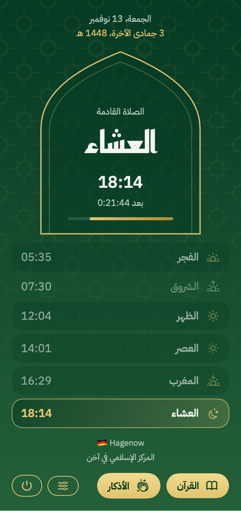
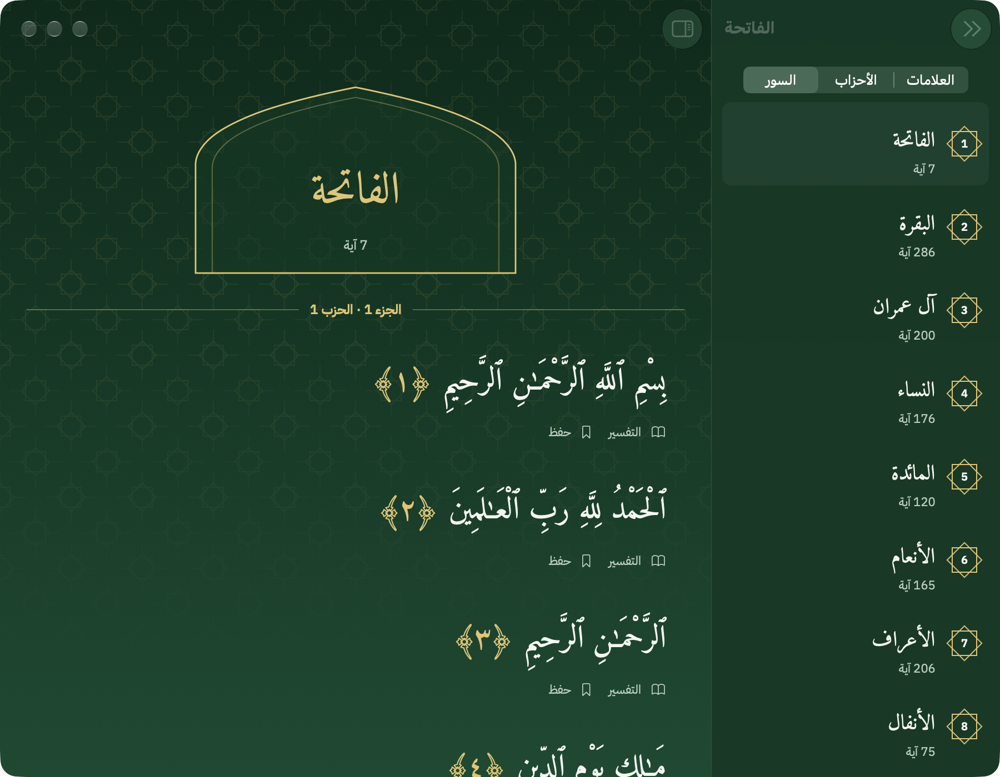
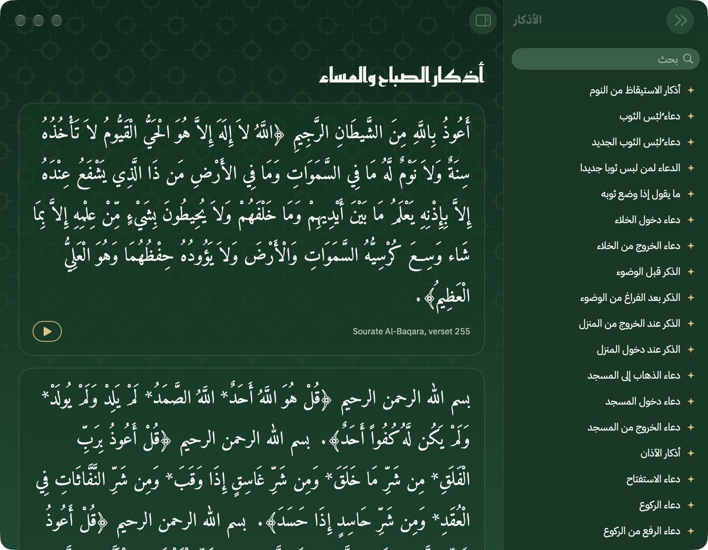
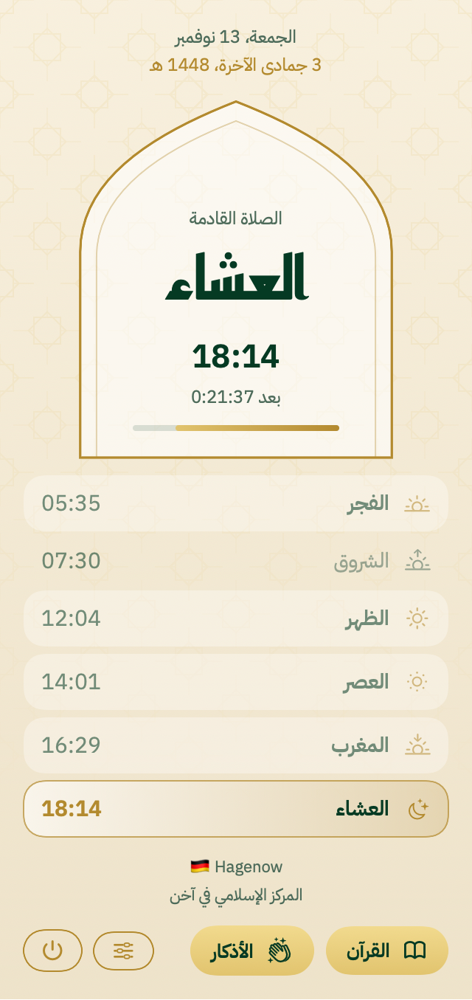
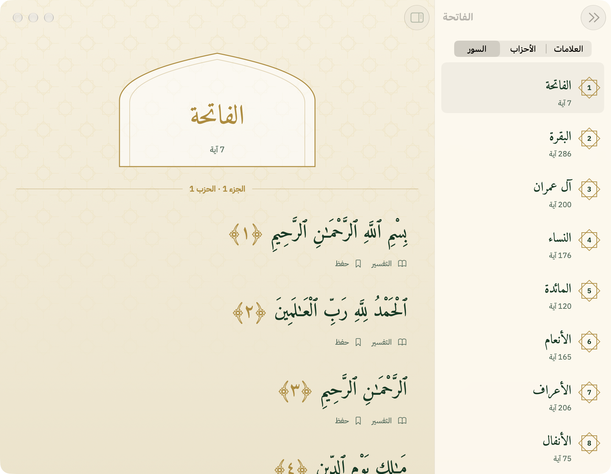
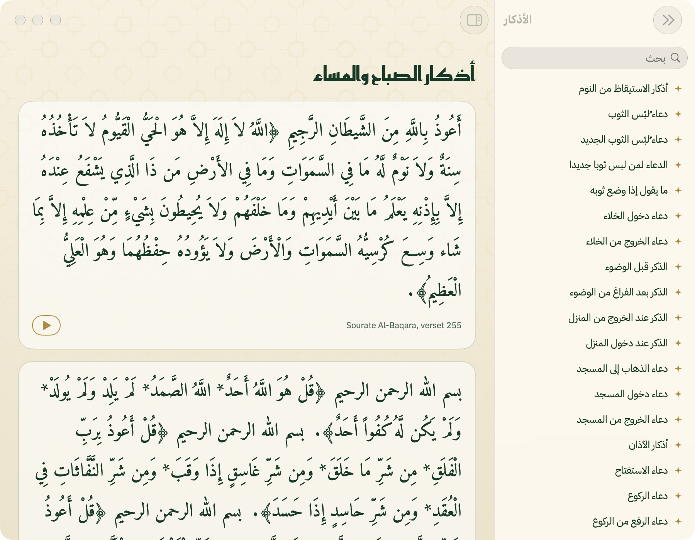

# Salat

Prayer times, adhan, Quran and adhkar. Free, no accounts, no tracking. Salat is and stays free.

In Arabic, English, French, German, Dutch, Spanish, Portuguese and Italian. The adhkar translations are in English and
French; the other languages show the English one.

- **Web app** (`apps/web`): an installable PWA on Cloudflare Workers.
  - Today's prayer times for your location, with push notifications at each prayer and 10 minutes before (choose which prayers).
  - Optional reminders for the morning and evening adhkar, and on Fridays for Surat al-Kahf and Jumuʿah.
  - Per-prayer minute adjustments to match your mosque, a Hijri date offset, and imsak/iftar during Ramadan.
  - A printable monthly timetable.
  - A Qibla compass.
  - A Quran reader with streamed recitation, read-along highlighting, juz/hizb markers, tafsir and bookmarks.
  - Hisn al-Muslim adhkar with audio.
- **Mac app** (`apps/macos`): a native menu-bar app.
  - Next prayer and countdown in the menu bar.
  - The full adhan at each prayer. Madinah (Sheikh Essam Bukhari) is the default; Makkah (Ali Ahmed Mulla, Fajr),
    Mishary Alafasy, Al-Aqsa and Abdul Basit download on first use, and you can add your own recording.
  - A Quran reader with eight reciters, read-along highlighting and bookmarks, available offline.
  - A monthly timetable (⌘4), printable.
  - Hisn al-Muslim adhkar in Arabic, English and French, with audio.
  - The same reminders, adjustments, Hijri offset and Ramadan times as the website.
  - A desktop and Notification Center widget with the next prayer and today's times.

Both apps compute the same prayer times to the minute. The website's method table is ported to Swift, and a shared
test fixture keeps the two in sync.

| Menu bar | Quran | Adhkar |
|---|---|---|
|  |  |  |
|  |  |  |

## Install the Mac app

1. Download `Salat-vX.Y.Z.zip` from [Releases](https://github.com/aminefourari/salat/releases).
2. Unzip it and move `Salat.app` to Applications.
3. Open it. The build is unsigned, so macOS blocks it the first time. Open **System Settings → Privacy & Security** and click **Open Anyway**, or run:

   ```sh
   xattr -dr com.apple.quarantine /Applications/Salat.app
   ```

It requires macOS 15 or later. Salat starts at login by default; you can change this in Settings → General.

Salat checks for new versions once a day and offers to install them (Settings → General → Updates). Updates come from
this repository's GitHub Releases through the project's own Worker, over HTTPS, and are checked against the release's
SHA-256. Versions before 1.1.0 don't have this yet, so update those once by hand.

## Development

```sh
npm install
npm run dev            # web app on :3000 (cp apps/web/.dev.vars.example apps/web/.dev.vars to send pushes locally)
npm test               # web tests (Vitest), incl. the web↔Mac parity fixture
npm run deploy         # build + wrangler deploy (Cloudflare Worker "salat")

brew install xcodegen  # once
npm run mac:test       # Swift tests
npm run mac:build      # → apps/macos/build/Salat.app
ditto apps/macos/build/Salat.app /Applications/Salat.app   # install locally (quit Salat first)
```

To refresh the screenshots, run `apps/macos/build/Salat.app/Contents/MacOS/Salat -snapshot DIR`. It renders the views
in dark and light, then quits.

## Releasing

CI (`.github/workflows/ci.yml`) runs the web and Swift tests and the type-check on every pull request and push to
`main`. On `main` it also applies the D1 migrations and deploys the Worker (repo secrets `CLOUDFLARE_API_TOKEN` and
`CLOUDFLARE_ACCOUNT_ID`).

Every push to `main` that touches `apps/macos/`, `data/` or `.github/workflows/release.yml` publishes the next patch
release automatically (`.github/workflows/release.yml`: tests, an unsigned `Salat.app` build, and a GitHub Release with
`Salat-vX.Y.Z.zip`). Installed apps offer it in Settings → General → Updates.

For a minor or major version, push a tag higher than the latest release (never reuse one):

```sh
git tag v1.2.0 && git push origin v1.2.0
```

## Data and credits

- **City names:** [GeoNames](https://www.geonames.org) `cities5000` (CC BY 4.0). The Worker and the Mac app both
  bundle them, so location lookups never leave our own infrastructure.
- **Morocco:** the official timetable of the Ministry of Habous (`habous.gov.ma/data/horaires-YYYY-MM.js`), imported
  once per month into the Worker's D1 database and served for the nearest listed city within 25 km, else calculated (Fajr 19°, Isha 17°). Loader and
  city coordinates (`apps/web/src/server/habous-cities.json`, from GeoNames, CC BY 4.0) come from
  [fr255-watchface](https://github.com/iliassjabali/fr255-watchface).
- **Country borders:** [country-coder](https://github.com/rapideditor/country-coder).
- **Quran text and recitations:** [quran.com](https://quran.com). The Mac app downloads recitations for offline use;
  the website streams them.
- **Adhkar:** Hisn al-Muslim via [hisnmuslim.com](https://www.hisnmuslim.com) (Arabic, English, audio) and the AR-FR
  ["La Citadelle du Musulman"](https://github.com/Kiwifu/la-citadelle-du-musulman) (French, references). The book is
  distributed free and not for sale.
- **Adhan recordings and fonts** (Amiri, Amiri Quran, Reem Kufi, IBM Plex Sans Arabic): see
  `apps/macos/Salat/Resources/ATTRIBUTION.md`.

Created in [T3 Code](https://t3.codes).
